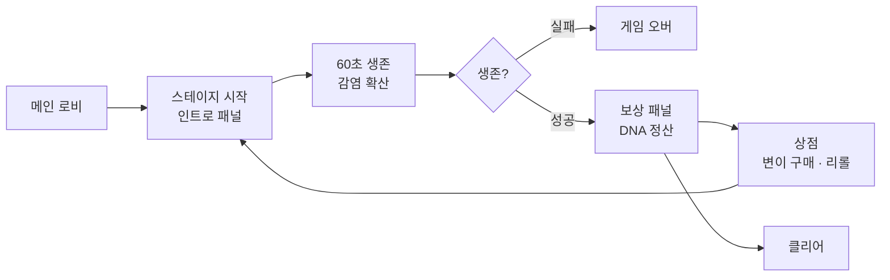

<div align="center">

# 감염 확산 로그라이트

**백신을 피해 도시를 감염시키고, DNA로 변이를 사들여 더 빠르게 퍼져라**

제한 시간 60초 · 스테이지마다 늘어나는 추종자 · 상점에서 고르는 변이

[](https://unity.com)
[](https://learn.microsoft.com/dotnet/csharp/)


</div>

<!--
  ▼ 플레이 GIF를 docs/gif/play.gif 로 올린 뒤, 이 주석의 시작/끝 기호만 지우세요.
<div align="center">
  
  <br><sub>시민을 감염시켜 행렬을 늘리고, 백신과 경찰을 피한다</sub>
</div>
-->

---

## 어떤 게임인가

플레이어는 **감염원**입니다. 거리를 달리며 중립 시민과 접촉하면 그들이 감염되어 **내 뒤를 따라오는 행렬**이 됩니다.
행렬이 길어질수록 세력은 커지지만, 동시에 **의료진과 경찰**이 반응하기 시작합니다.

곳곳에 놓인 **백신 장애물**은 닿는 순간 체력을 깎습니다.
스테이지를 버텨 내면 모은 **DNA**로 상점에서 **변이(Mutation)** 를 사서 다음 스테이지에 도전합니다.

> [!NOTE]
> **목표** — 제한 시간 60초를 버티며 최대한 많은 시민을 감염시킨다
> **위협** — 백신 장애물(접촉 데미지), 의료진·경찰의 원거리 투사체
> **성장** — 획득한 DNA로 일반/희귀 변이 카드를 구매

## 진행 흐름



## 주요 시스템

| 시스템 | 스크립트 | 설명 |
|---|---|---|
| **추종자 행렬** | `FollowerManager` | 플레이어 이동 경로를 기록해 뒤따르게 함. 한 줄이 가득 차면 다음 줄로 배치 |
| **오브젝트 풀** | `PoolManager` | 시민·의료진·경찰·감염체·투사체를 타입별 큐로 재사용 |
| **감염 전파** | `Infection` | 접촉 시 추종자로 전환하고 원본 오브젝트는 풀로 반납 |
| **변이 상점** | `ShopManager` | DNA로 일반/희귀 변이 구매, 리롤 비용 관리 |
| **전역 매니저** | `Managers` | 페이드·사운드를 싱글턴으로 묶어 씬 전환 간 유지 |
| **스테이지 진행** | `GameScene` / `GameInstance` | 스테이지 레벨·보유 DNA를 씬 간에 전달 |

## 구현 포인트

### 추종자를 물리 계산 없이 **경로 기록**으로 따라오게 하기

추종자마다 추적 로직을 돌리면 수가 늘수록 비용이 커집니다.
대신 플레이어가 **일정 거리를 움직일 때마다 위치를 큐에 기록**하고, 각 추종자는 자기 순번에 해당하는 과거 위치를 읽습니다.

```csharp
void Update()
{
    // 일정 거리마다 position 기록
    float dist = Vector3.Distance(transform.position, positionHistory[0]);
    if (dist >= 1.5f)
        positionHistory.Insert(0, transform.position);
}
```

추종자 수가 늘어도 추가되는 비용은 **인덱스 조회뿐**입니다.

### 생성·파괴 대신 **타입별 풀링**

시민이 감염되는 순간 원본은 파괴되지 않고 풀로 돌아갑니다.
`PoolType`으로 분류해 두어 반납할 때 어느 풀인지 역조회할 수 있습니다.

```csharp
public enum PoolType { Neutral, Medic, Police, Infected, Projectile }

// 감염 성공 시: 추종자로 전환하고 원본은 풀에 반납
hopackCarrier.followerManager.MakeFollower();
PoolType type = PoolManager.Instance.GetPoolType(gameObject);
PoolManager.Instance.Return(type, gameObject);
```

### 그 밖에

- **씬 간 상태 유지** — `GameInstance`에 스테이지 레벨과 보유 DNA를 보관해 로비 ↔ 게임 ↔ 상점을 오가도 진행도 유지
- **데이터 주도 변이** — `MutationData` / `RareMutationData`를 직렬화 클래스로 정의해 이름·설명·쿨다운·가격을 인스펙터에서 관리
- **연출** — DOTween으로 카메라 진입·패널 전환, `FadeManager`로 씬 전환 페이드

<details>
<summary><b>씬 구성</b></summary>

| 씬 | 역할 |
|---|---|
| `MainLobby` / `kyg_Lobby` | 시작 화면 |
| `GameScene` / `kyg_game` | 스테이지 플레이 |
| `kyg_Infinity` | 무한 모드 |
| `Shop` | 변이 상점 |
| `kyg_win` / `kyg_gameover` | 클리어 · 게임 오버 |

</details>

<details>
<summary><b>폴더 구조</b></summary>

```
Assets/
├─ Scripts/
│  ├─ Player/     PlayerController · FollowerManager · PlayerHealth · PlayerUI
│  ├─ Enemy/      EnemyChase · EnemyFire · EnemyProjectile · Infection · ContactDamage
│  ├─ Managers/   PoolManager · SpawnManager · SoundManager · FadeManager · GameInstance
│  ├─ Map/        MapManager · PlaneInfo
│  ├─ Scene/      GameScene · MainLobby
│  └─ UI/         RewardPanel · HeartUI
├─ Data/          StageSpawnData
├─ Scenes/        로비 · 게임 · 상점 · 결과
└─ Plugins/       DOTween · SerializedCollections
```

</details>

## 실행

```
Unity Hub → Add → 이 폴더 선택 (Unity 6000.0.55f1)
Assets/Scenes/MainLobby 열고 Play
```

<div align="right"><sub>1주차 · 2026.09.06 ~ 09.08</sub></div>
